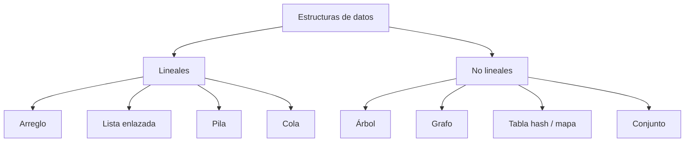

# Estructuras de datos – TdeA

Repositorio informativo sobre las estructuras de datos fundamentales: qué son, cómo funcionan, cuándo usarlas y cómo se ven en código. Los ejemplos están en Python.

## ¿Qué es una estructura de datos?

Una forma de **organizar y almacenar datos** para poder acceder a ellos y modificarlos de manera eficiente. Elegir bien la estructura puede ser la diferencia entre un programa que responde en milisegundos y uno que tarda minutos.

## Clasificación



### Lineales
Los datos van uno detrás de otro, en secuencia.

| Tipo | Cómo funciona | Documento |
|---|---|---|
| Arreglo (array) | Tamaño fijo, acceso por posición | [arreglo](docs/lineales/arreglo.md) |
| Lista enlazada | Cada elemento apunta al siguiente | [lista-enlazada](docs/lineales/lista-enlazada.md) |
| Pila (stack) | Último en entrar, primero en salir (LIFO) | [pila](docs/lineales/pila.md) |
| Cola (queue) | Primero en entrar, primero en salir (FIFO) | [cola](docs/lineales/cola.md) |

### No lineales
Los datos se organizan en jerarquías o conexiones, no en fila.

| Tipo | Cómo funciona | Documento |
|---|---|---|
| Árbol | Jerarquía de padres e hijos (carpetas, menús) | [arbol](docs/no-lineales/arbol.md) |
| Grafo | Nodos conectados entre sí (redes sociales, mapas) | [grafo](docs/no-lineales/grafo.md) |
| Tabla hash / mapa | Pares clave → valor con búsqueda muy rápida | [tabla-hash](docs/no-lineales/tabla-hash.md) |
| Conjunto (set) | Elementos sin repetir | [conjunto](docs/no-lineales/conjunto.md) |

## Comparativa

Resumen de complejidades y criterios de elección en [docs/comparativa.md](docs/comparativa.md).

## Estructura del repo

```
estructuras-datos-tdea/
├── README.md
└── docs/
    ├── comparativa.md
    ├── lineales/
    │   ├── arreglo.md
    │   ├── lista-enlazada.md
    │   ├── pila.md
    │   └── cola.md
    └── no-lineales/
        ├── arbol.md
        ├── grafo.md
        ├── tabla-hash.md
        └── conjunto.md
```

> Los diagramas usan [Mermaid](https://mermaid.js.org/), que GitHub renderiza automáticamente.
