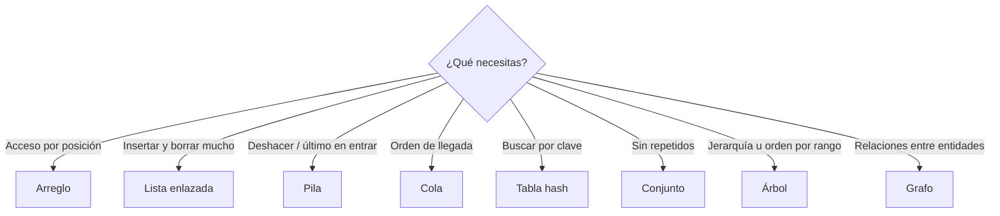

# Comparativa

## Complejidades en el caso promedio

| Estructura | Acceso | Búsqueda | Inserción | Eliminación |
|---|---|---|---|---|
| Arreglo | O(1) | O(n) | O(n) | O(n) |
| Lista enlazada | O(n) | O(n) | O(1)\* | O(1)\* |
| Pila | O(n) | O(n) | O(1) | O(1) |
| Cola | O(n) | O(n) | O(1) | O(1) |
| Árbol binario de búsqueda | – | O(log n) | O(log n) | O(log n) |
| Tabla hash | – | O(1) | O(1) | O(1) |
| Conjunto | – | O(1) | O(1) | O(1) |

\* Insertar o eliminar es O(1) si ya se tiene el nodo (por ejemplo, al inicio); encontrarlo cuesta O(n).
Pila y cola solo permiten insertar y quitar en sus extremos.
El grafo no aparece porque su costo depende de la representación; ver [grafo](no-lineales/grafo.md).

## ¿Cuál elegir?

## Regla práctica

1. Si necesitas **orden de acceso** (último o primero), piensa en pila o cola.
2. Si necesitas **buscar por clave**, piensa en tabla hash.
3. Si necesitas **recorrer ordenado o por rango**, piensa en árbol.
4. Si los datos son **relaciones**, piensa en grafo.
5. Ante la duda, empieza con un arreglo (`list`) o un `dict` y optimiza solo si mides un problema.
