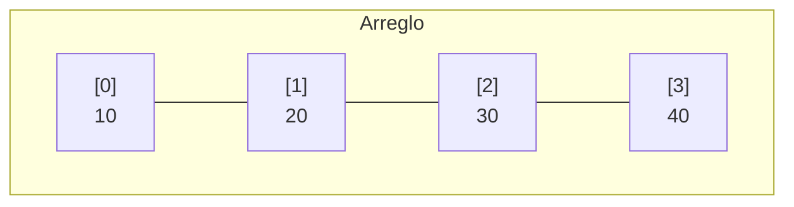

# Arreglo (array)

Colección de elementos almacenados en **posiciones contiguas de memoria**, accesibles por un índice que empieza en 0. En los lenguajes clásicos su tamaño es fijo.



## Características

- Acceso por índice en tiempo constante.
- Insertar o eliminar en medio obliga a **desplazar** elementos.
- Tamaño fijo (en Python, `list` es un arreglo dinámico que se redimensiona solo).

## Código

```python
numeros = [10, 20, 30, 40]

print(numeros[2])        # 30  -> acceso O(1)
numeros[1] = 25          # modificar O(1)
numeros.append(50)       # agregar al final, O(1) amortizado
numeros.insert(1, 15)    # insertar en medio, O(n): desplaza elementos
numeros.pop(0)           # eliminar al inicio, O(n)

for n in numeros:        # recorrer O(n)
    print(n)
```

## Complejidad

| Operación | Costo |
|---|---|
| Acceso por índice | O(1) |
| Búsqueda (sin ordenar) | O(n) |
| Insertar / eliminar al final | O(1) |
| Insertar / eliminar al inicio o en medio | O(n) |

## Cuándo usarlo

Cuando se conoce el tamaño aproximado y se accede mucho por posición: calificaciones de un curso, píxeles de una imagen, matrices.
