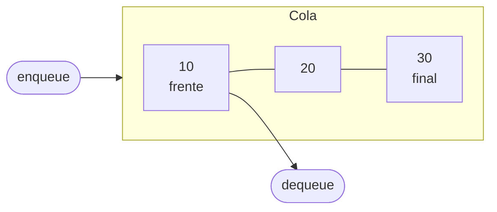

# Cola (queue)

Estructura **FIFO** (*First In, First Out*): el primero en entrar es el primero en salir. Como la fila de un banco.



## Operaciones

| Operación | Descripción | Costo |
|---|---|---|
| `enqueue(x)` | Agrega `x` al final | O(1) |
| `dequeue()` | Quita y devuelve el elemento del frente | O(1) |
| `frente()` | Consulta el frente sin quitarlo | O(1) |
| `esta_vacia()` | Indica si no hay elementos | O(1) |

## Código

Usar `list.pop(0)` cuesta O(n); para una cola real se usa `collections.deque`.

```python
from collections import deque


class Cola:
    def __init__(self):
        self._items = deque()

    def enqueue(self, x):
        self._items.append(x)

    def dequeue(self):
        if self.esta_vacia():
            raise IndexError("la cola está vacía")
        return self._items.popleft()

    def frente(self):
        if self.esta_vacia():
            raise IndexError("la cola está vacía")
        return self._items[0]

    def esta_vacia(self):
        return not self._items


c = Cola()
c.enqueue("Ana")
c.enqueue("Luis")
c.enqueue("Marta")
print(c.dequeue())  # Ana
print(c.frente())   # Luis
```

## Variantes

- **Cola circular**: reutiliza el espacio liberado al frente.
- **Doble cola (deque)**: inserta y elimina por ambos extremos.
- **Cola de prioridad**: sale primero el de mayor prioridad, no el más antiguo (suele implementarse con un *heap*).

```python
import heapq

tareas = []
heapq.heappush(tareas, (2, "enviar correo"))
heapq.heappush(tareas, (1, "apagar incendio"))
print(heapq.heappop(tareas))  # (1, 'apagar incendio')
```

## Usos comunes

- Cola de impresión.
- Atención de solicitudes en un servidor.
- Recorrido en anchura (BFS) de árboles y grafos.
- Colas de mensajes entre servicios.
