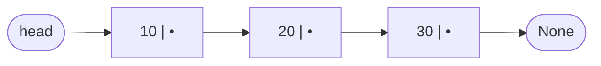

# Lista enlazada

Secuencia de **nodos**; cada nodo guarda un dato y una referencia al siguiente. Los nodos no están contiguos en memoria.



## Variantes

- **Simple**: cada nodo apunta al siguiente.
- **Doble**: cada nodo apunta al siguiente y al anterior.
- **Circular**: el último nodo apunta al primero.

## Código

```python
class Nodo:
    def __init__(self, dato):
        self.dato = dato
        self.siguiente = None


class ListaEnlazada:
    def __init__(self):
        self.cabeza = None

    def agregar_al_inicio(self, dato):      # O(1)
        nodo = Nodo(dato)
        nodo.siguiente = self.cabeza
        self.cabeza = nodo

    def agregar_al_final(self, dato):       # O(n)
        nodo = Nodo(dato)
        if self.cabeza is None:
            self.cabeza = nodo
            return
        actual = self.cabeza
        while actual.siguiente:
            actual = actual.siguiente
        actual.siguiente = nodo

    def eliminar(self, dato):               # O(n)
        actual, previo = self.cabeza, None
        while actual:
            if actual.dato == dato:
                if previo:
                    previo.siguiente = actual.siguiente
                else:
                    self.cabeza = actual.siguiente
                return True
            previo, actual = actual, actual.siguiente
        return False

    def __iter__(self):
        actual = self.cabeza
        while actual:
            yield actual.dato
            actual = actual.siguiente


lista = ListaEnlazada()
lista.agregar_al_final(10)
lista.agregar_al_final(20)
lista.agregar_al_inicio(5)
print(list(lista))  # [5, 10, 20]
```

## Complejidad

| Operación | Costo |
|---|---|
| Acceso por posición | O(n) |
| Insertar al inicio | O(1) |
| Insertar / eliminar conociendo el nodo previo | O(1) |
| Búsqueda | O(n) |

## Arreglo vs. lista enlazada

| | Arreglo | Lista enlazada |
|---|---|---|
| Acceso por índice | O(1) | O(n) |
| Insertar al inicio | O(n) | O(1) |
| Memoria | Contigua | Dispersa, con un puntero extra por nodo |

## Cuándo usarla

Cuando hay muchas inserciones y eliminaciones y poco acceso por posición: historial de navegación, base para implementar pilas y colas.
