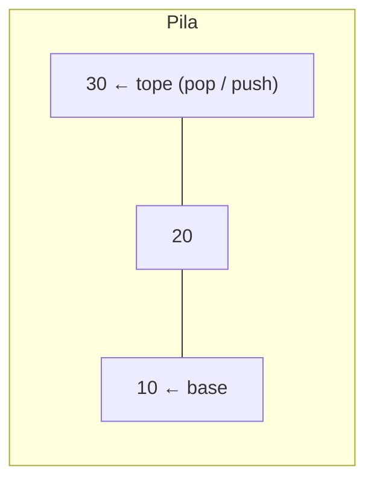

# Pila (stack)

Estructura **LIFO** (*Last In, First Out*): el último elemento en entrar es el primero en salir. Como una pila de platos: solo se toca el de arriba.



## Operaciones

| Operación | Descripción | Costo |
|---|---|---|
| `push(x)` | Apila `x` en el tope | O(1) |
| `pop()` | Desapila y devuelve el tope | O(1) |
| `peek()` | Consulta el tope sin quitarlo | O(1) |
| `esta_vacia()` | Indica si no hay elementos | O(1) |

## Código

```python
class Pila:
    def __init__(self):
        self._items = []

    def push(self, x):
        self._items.append(x)

    def pop(self):
        if self.esta_vacia():
            raise IndexError("la pila está vacía")
        return self._items.pop()

    def peek(self):
        if self.esta_vacia():
            raise IndexError("la pila está vacía")
        return self._items[-1]

    def esta_vacia(self):
        return not self._items


p = Pila()
p.push(10)
p.push(20)
p.push(30)
print(p.pop())   # 30
print(p.peek())  # 20
```

## Ejemplo clásico: paréntesis balanceados

```python
def balanceado(texto):
    pares = {")": "(", "]": "[", "}": "{"}
    pila = []
    for c in texto:
        if c in "([{":
            pila.append(c)
        elif c in pares:
            if not pila or pila.pop() != pares[c]:
                return False
    return not pila


print(balanceado("{[()]}"))  # True
print(balanceado("{[(])}"))  # False
```

## Usos comunes

- Deshacer / rehacer en editores.
- Historial de navegación (botón "atrás").
- Pila de llamadas de funciones (recursión).
- Evaluación de expresiones y validación de sintaxis.
