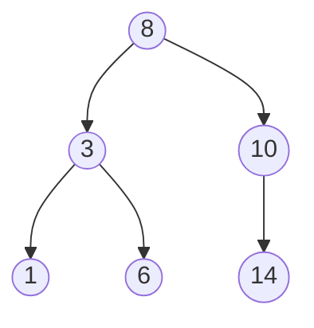

# Árbol

Estructura jerárquica formada por **nodos** conectados por aristas. Tiene una **raíz**, y cada nodo puede tener **hijos**. No tiene ciclos.



## Vocabulario

- **Raíz**: nodo sin padre (8).
- **Hoja**: nodo sin hijos (1, 6, 14).
- **Altura**: longitud del camino más largo de la raíz a una hoja.
- **Subárbol**: un nodo junto con todos sus descendientes.

## Árbol binario de búsqueda (BST)

Árbol binario donde, para cada nodo, los valores del subárbol izquierdo son **menores** y los del derecho **mayores**. Eso permite buscar descartando la mitad en cada paso.

```python
class Nodo:
    def __init__(self, valor):
        self.valor = valor
        self.izq = None
        self.der = None


class BST:
    def __init__(self):
        self.raiz = None

    def insertar(self, valor):
        self.raiz = self._insertar(self.raiz, valor)

    def _insertar(self, nodo, valor):
        if nodo is None:
            return Nodo(valor)
        if valor < nodo.valor:
            nodo.izq = self._insertar(nodo.izq, valor)
        elif valor > nodo.valor:
            nodo.der = self._insertar(nodo.der, valor)
        return nodo

    def buscar(self, valor):
        nodo = self.raiz
        while nodo:
            if valor == nodo.valor:
                return True
            nodo = nodo.izq if valor < nodo.valor else nodo.der
        return False


arbol = BST()
for v in [8, 3, 10, 1, 6, 14]:
    arbol.insertar(v)
print(arbol.buscar(6))   # True
print(arbol.buscar(7))   # False
```

## Recorridos

```python
def inorden(nodo):       # izq, raíz, der  -> valores ordenados en un BST
    if nodo:
        yield from inorden(nodo.izq)
        yield nodo.valor
        yield from inorden(nodo.der)

def preorden(nodo):      # raíz, izq, der
    if nodo:
        yield nodo.valor
        yield from preorden(nodo.izq)
        yield from preorden(nodo.der)

def postorden(nodo):     # izq, der, raíz
    if nodo:
        yield from postorden(nodo.izq)
        yield from postorden(nodo.der)
        yield nodo.valor

print(list(inorden(arbol.raiz)))   # [1, 3, 6, 8, 10, 14]
print(list(preorden(arbol.raiz)))  # [8, 3, 1, 6, 10, 14]
```

El recorrido **por niveles** (anchura) usa una [cola](../lineales/cola.md).

## Complejidad del BST

| Operación | Promedio | Peor caso (árbol degenerado) |
|---|---|---|
| Buscar | O(log n) | O(n) |
| Insertar | O(log n) | O(n) |
| Eliminar | O(log n) | O(n) |

Los árboles autobalanceados (AVL, rojinegro) garantizan O(log n) incluso en el peor caso.

## Usos comunes

- Sistema de archivos (carpetas y subcarpetas).
- DOM de una página web.
- Menús jerárquicos y organigramas.
- Índices de bases de datos (árboles B).
