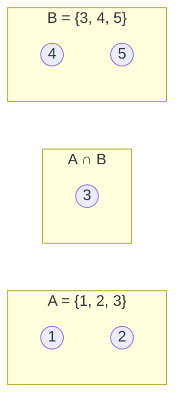

# Conjunto (set)

Colección de elementos **sin repetir** y, normalmente, sin orden. Se implementa casi siempre con una [tabla hash](tabla-hash.md) donde solo se guardan las claves.



## Código

```python
a = {1, 2, 3}
b = {3, 4, 5}

a.add(4)              # agregar        O(1) promedio
a.add(4)              # no cambia nada: ya existe
a.discard(1)          # eliminar       O(1) promedio
print(3 in a)         # pertenencia    O(1) promedio

print(a | b)          # unión:        {2, 3, 4, 5}
print(a & b)          # intersección: {3, 4}
print(a - b)          # diferencia:   {2}
print(a ^ b)          # simétrica:    {2, 5}
```

### Quitar duplicados

```python
correos = ["a@x.com", "b@x.com", "a@x.com"]
unicos = set(correos)
print(len(unicos))  # 2
```

Con una lista, `x in lista` cuesta O(n); con un conjunto, O(1) promedio. Para verificar pertenencia repetidamente conviene convertir a `set`.

## Operaciones

| Operación | Descripción | Costo promedio |
|---|---|---|
| `add(x)` | Agrega un elemento | O(1) |
| `x in s` | Pertenencia | O(1) |
| `discard(x)` | Elimina si existe | O(1) |
| `a \| b` | Unión | O(len(a) + len(b)) |
| `a & b` | Intersección | O(min(len(a), len(b))) |

## Usos comunes

- Eliminar duplicados.
- Marcar vértices visitados en un recorrido de [grafo](grafo.md).
- Comparar grupos: usuarios en común, etiquetas compartidas.
- Validar pertenencia a una lista de permitidos o bloqueados.
