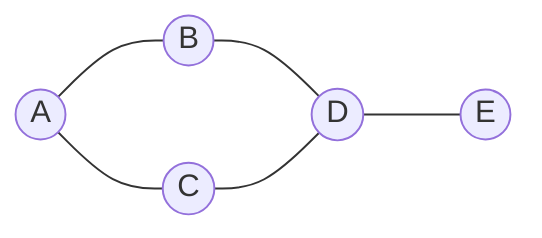
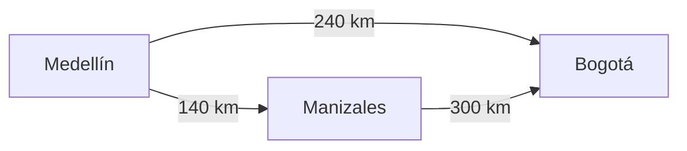

# Grafo

Conjunto de **vértices** (nodos) conectados por **aristas**. A diferencia del árbol, puede tener ciclos y no tiene raíz.



## Tipos

- **No dirigido**: la arista va en ambos sentidos (amistad en Facebook).
- **Dirigido**: la arista tiene sentido (seguir a alguien en Instagram).
- **Ponderado**: las aristas tienen un peso (distancia entre ciudades).



## Representación: lista de adyacencia

Cada vértice guarda la lista de sus vecinos. Es la representación más usada para grafos dispersos.

```python
grafo = {
    "A": ["B", "C"],
    "B": ["A", "D"],
    "C": ["A", "D"],
    "D": ["B", "C", "E"],
    "E": ["D"],
}
```

La alternativa es la **matriz de adyacencia**: una tabla n×n donde `m[i][j] = 1` si existe arista de i a j. Consulta una arista en O(1), pero ocupa O(n²).

## Recorridos

### Anchura (BFS): nivel por nivel, usa una cola

```python
from collections import deque

def bfs(grafo, inicio):
    visitados = {inicio}
    cola = deque([inicio])
    orden = []
    while cola:
        v = cola.popleft()
        orden.append(v)
        for vecino in grafo[v]:
            if vecino not in visitados:
                visitados.add(vecino)
                cola.append(vecino)
    return orden

print(bfs(grafo, "A"))  # ['A', 'B', 'C', 'D', 'E']
```

BFS encuentra el camino con **menos aristas** en grafos no ponderados.

### Profundidad (DFS): hasta el fondo y vuelve, usa una pila

```python
def dfs(grafo, inicio):
    visitados = set()
    pila = [inicio]
    orden = []
    while pila:
        v = pila.pop()
        if v in visitados:
            continue
        visitados.add(v)
        orden.append(v)
        for vecino in reversed(grafo[v]):
            pila.append(vecino)
    return orden

print(dfs(grafo, "A"))  # ['A', 'B', 'D', 'C', 'E']
```

## Complejidad (V vértices, E aristas)

| | Lista de adyacencia | Matriz de adyacencia |
|---|---|---|
| Memoria | O(V + E) | O(V²) |
| ¿Existe arista u–v? | O(grado de u) | O(1) |
| BFS / DFS | O(V + E) | O(V²) |

## Usos comunes

- Redes sociales (quién conoce a quién).
- Mapas y rutas (Google Maps usa variantes de Dijkstra y A*).
- Dependencias entre paquetes o tareas.
- Topología de redes de computadores.
