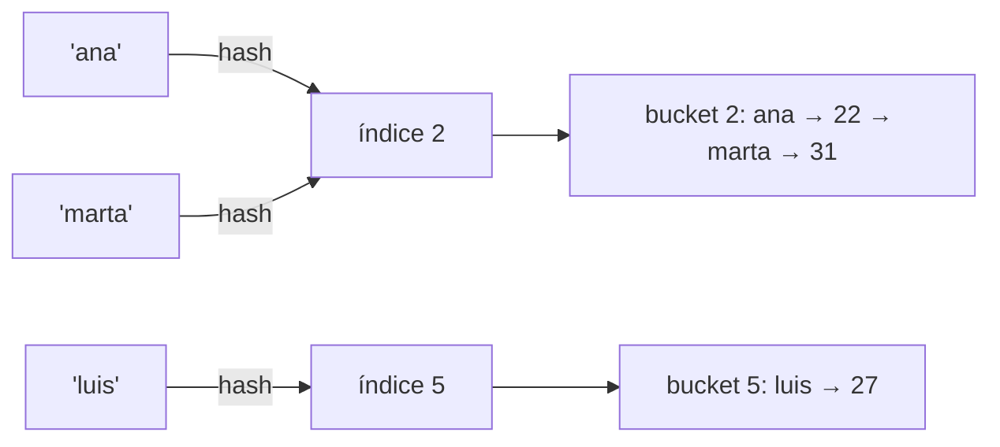

# Tabla hash / mapa

Almacena pares **clave → valor**. Una **función hash** convierte la clave en un índice de un arreglo interno, lo que permite buscar, insertar y eliminar en tiempo promedio constante.



## Colisiones

Dos claves distintas pueden producir el mismo índice (como `ana` y `marta` arriba). Estrategias comunes:

- **Encadenamiento**: cada posición guarda una lista de pares.
- **Direccionamiento abierto**: se busca otra posición libre (sondeo lineal, cuadrático, doble hash).

## Código

En Python el mapa es el `dict`:

```python
edades = {"ana": 22, "luis": 27}

edades["marta"] = 31          # insertar  O(1) promedio
print(edades["ana"])          # buscar    O(1) promedio
print("luis" in edades)       # True
del edades["luis"]            # eliminar  O(1) promedio

for nombre, edad in edades.items():
    print(nombre, edad)
```

### Implementación mínima con encadenamiento

```python
class TablaHash:
    def __init__(self, capacidad=8):
        self.buckets = [[] for _ in range(capacidad)]

    def _indice(self, clave):
        return hash(clave) % len(self.buckets)

    def poner(self, clave, valor):
        bucket = self.buckets[self._indice(clave)]
        for i, (k, _) in enumerate(bucket):
            if k == clave:
                bucket[i] = (clave, valor)
                return
        bucket.append((clave, valor))

    def obtener(self, clave, defecto=None):
        for k, v in self.buckets[self._indice(clave)]:
            if k == clave:
                return v
        return defecto


t = TablaHash()
t.poner("ana", 22)
t.poner("luis", 27)
print(t.obtener("ana"))   # 22
```

## Complejidad

| Operación | Promedio | Peor caso (muchas colisiones) |
|---|---|---|
| Buscar | O(1) | O(n) |
| Insertar | O(1) | O(n) |
| Eliminar | O(1) | O(n) |

Las claves deben ser **inmutables y hashables** (en Python: `str`, `int`, `tuple`, no `list`). Los mapas no garantizan un orden de búsqueda por rango; para eso se usa un árbol.

## Usos comunes

- Contar frecuencias (palabras en un texto).
- Cachés.
- Índices rápidos por identificador (cédula → persona).
- Tablas de símbolos en compiladores.
